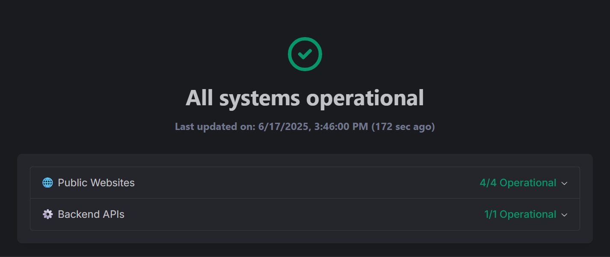

<div align="center">
    <h1>Project Uptime Monitoring 💻</h1>
    <p>Fork of <a href="https://github.com/lyc8503/UptimeFlare" target="_blank">UptimeFlare</a></p>
</div>



---

[Original README](UptimeFlare.md)

## Local development

The status page is a static Next.js export served by Cloudflare Pages, with Pages Functions in `functions/` for the KV-backed API (`/api/state`, `/api/data`) and optional password protection.

```bash
# Run the monitoring worker locally, then trigger a check with: curl "http://localhost:8787/__scheduled"
cd worker && npm run dev

# Build the page and serve it with the Pages Functions and the same local KV (http://localhost:8788)
npm run preview

# Optional: hot-reloading UI on http://localhost:3000, with /api/* forwarded to the preview server above
npm run dev
```
